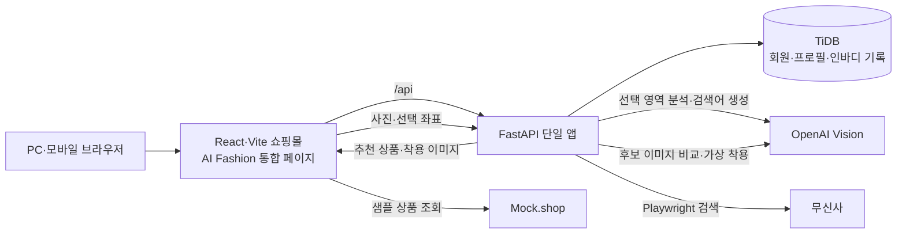

# ONFIT

    

**ONFIT은 쇼핑몰 탐색, 스타일 큐레이션, 체형 기반 3D 미리보기, 사진 속 패션 상품 검색과 AI 가상 착용을 한곳에서 경험하도록 만든 4인 팀 프로젝트입니다.**

[GitHub 저장소](https://github.com/hsoshh1111-sys/Semiproject) · [프로젝트 소개 페이지 (준비 중)](https://kimchi-2025.github.io/ONFIT/) — 소개 페이지는 서비스 실행 데모가 아닙니다.

## 1. 프로젝트 소개 및 주요 기능

| 영역 | 현재 구현 내용 |
| --- | --- |
| 쇼핑몰·회원 | 반응형 상품 탐색, 회원가입·로그인, 스타일·색상·핏 선호 저장. 홈 상품·일반 추천 코디·가격 화면에는 시연용 데이터가 포함됩니다. |
| 시즌 코디 | 겨울 코디를 연령대·성별로 탐색하고 Mock.shop **샘플 카탈로그**의 아우터·니트·소품을 조합합니다. 마음에 드는 상품은 브라우저에 찜할 수 있습니다. |
| 3D 피팅 | 치수·체형 프리셋 또는 확인한 인바디 수치를 적용해 3D 마네킹과 의류를 미리 봅니다. 회전, 색상·의류 변경을 지원하며 실제 사이즈 적합성 판정은 아닙니다. |
| AI Fashion | 사진 촬영·업로드 → 의류 영역 그리기 → Vision 분석 → 무신사 유사 상품 검색·추천 → 선택 상품의 AI 가상 착용·결과 비교·저장으로 이어집니다. |
| 기타 | 시즌 코디 찜 목록을 보여 주는 옷장, 시연용 가격 인사이트·판매처 비교, 개인정보를 가린 가입 현황 관리자 데모를 제공합니다. |

## 2. Architecture & Data Pipeline



AI Fashion은 사용자가 그린 다각형과 원본 사진을 분석에 전달합니다. 검색용 이미지를 잘라 무신사 상품 후보를 수집한 뒤, 후보 이미지를 비교해 추천합니다. 사용자가 상품을 고르고 실행할 때만 가상 착용 이미지를 생성합니다. 메인 React 앱은 공통 Header/Footer를 사용하며 AI Fashion 페이지를 지연 로딩합니다.

## 3. Key Technical Challenges & Solutions

| 문제 | 접근과 현재 상태 |
| --- | --- |
| 사진 속 일부 아이템을 상품 검색어로 연결 | 자유형 선택 좌표를 검증하고 Vision으로 상품 특징·검색어를 추출했습니다. Playwright로 수집한 후보를 의류 유형으로 걸러 이미지 비교를 거쳐 추천합니다. |
| 별도 React 앱의 디자인 충돌 | AI Fashion을 메인 frontend의 지연 로딩 페이지로 복사·통합하고 Shadow DOM으로 스타일을 격리했습니다. 공통 Header/Footer와 로컬 /api 프록시를 공유하며 원본 ai-fashion 앱은 보존했습니다. |
| Render Free에서 Chromium 메모리 한계 | 추천 동시 실행 제한, 이미지 축소·캐시 상한, 브라우저 정리 및 컨테이너 메모리 진단 로그를 적용했습니다. **512MB 환경의 OOM은 아직 해결 완료로 검증되지 않았습니다.** |

## 4. Tech Stack

| 구분 | 확인된 기술 |
| --- | --- |
| Frontend | React 19, Vite 8, Tailwind CSS, Three.js·React Three Fiber |
| Backend | Python, FastAPI, SQLAlchemy, Pydantic |
| AI / Machine Learning | OpenAI Vision·Images API, Pillow 기반 이미지 전처리 |
| RPA / Data Processing | Playwright Chromium, BeautifulSoup |
| Database | TiDB Cloud(MySQL 호환), PyMySQL, Alembic |
| Infrastructure / Deployment | Docker 멀티스테이지 빌드 설정, Render 배포 설정·실험, 향후 AWS EC2 검토 |

## 5. API Architecture / Directory Structure

```text
frontend/src/                       메인 React 앱·공통 Header/Footer·쇼핑몰·3D 피팅
frontend/src/features/ai-fashion/   통합 AI Fashion 페이지·컴포넌트·API 클라이언트
ai-fashion/                         보존 중인 독립 React 앱
backend/app/main.py                 단일 FastAPI 진입점·라우터·정적 파일 마운트
backend/app/api/                    회원·프로필·코디·상품·가격 API
backend/app/features/              3D 피팅·인바디·2D 피팅 관련 API
backend/routers/circle_search.py   AI Fashion API
backend/services/                 Vision·무신사 검색·추천·가상 착용 처리
```

핵심 AI Fashion API는 POST /api/circle-search/segment(선택 영역 분석), POST /api/circle-search/recommend(검색·추천), POST /api/circle-search/try-on(가상 착용)입니다. 쇼핑몰 API는 /api/auth/*, /api/profiles/*, /api/fitting/*, /api/inbody/* 등을 사용합니다. GET /health는 서버 상태 확인용입니다.

## 6. 실행 및 배포

로컬 개발은 **FastAPI 8000 + 통합 React/Vite 5173** 두 서버로 실행합니다(Windows PowerShell 기준).

```powershell
# 터미널 1: backend/requirements.txt와 Playwright Chromium 설치, backend/.env 설정 후
cd backend
.\.venv\Scripts\python.exe -m uvicorn app.main:app --reload --host 127.0.0.1 --port 8000

# 터미널 2
cd frontend
npm.cmd ci
npm.cmd run dev
```

쇼핑몰은 http://127.0.0.1:5173/, 통합 AI Fashion은 http://127.0.0.1:5173/ai-fashion/에서 엽니다. Vite가 /api를 로컬 FastAPI로 프록시하므로 개발용 VITE_API_BASE_URL은 비우거나 /api로 설정합니다. 첫 실행 시 backend 가상환경에 requirements.txt를 설치하고 python -m playwright install chromium을 실행합니다.

환경변수는 .env.example을 참고해 **값을 직접 설정**합니다. 회원·인바디 저장에는 DATABASE_URL 또는 TIDB_HOST, TIDB_PORT, TIDB_USERNAME, TIDB_PASSWORD, TIDB_DATABASE와 SECRET_KEY가 필요합니다. AI Fashion에는 backend/.env 또는 프로세스 환경변수의 OPENAI_API_KEY가 필요하며 OPENAI_VISION_MODEL, OPENAI_TRYON_MODEL은 선택 설정입니다. 키와 접속 문자열은 저장소에 넣지 않습니다.

render.yaml은 팀 배포 설정이고 Dockerfile.ajb는 별도 단일 컨테이너 실험용입니다. **현재 Dockerfile과 FastAPI 정적 마운트는 보존된 독립 ai-fashion/dist를 별도로 제공**하므로, 통합 React의 /ai-fashion/를 운영 주소에서 제공하려면 정적 라우팅·빌드 설정을 추가로 맞춰야 합니다. Render Free의 Chromium 메모리 문제는 미해결이며, AWS EC2 배포는 향후 계획입니다.

## 7. 구현 현황 및 향후 개선 계획

- **구현:** 통합 React 화면, 회원·프로필 API, 시즌 코디 샘플 탐색, 3D 체형 미리보기, AI Fashion의 검색·가상 착용 흐름.
- **시연·제약:** 홈 상품·일반 추천 코디·가격 비교 화면은 예시 데이터가 포함됩니다. 별도 /api/tryon2d/jobs는 기본 모델 어댑터가 미연결인 API 프로토타입이며 AI Fashion의 가상 착용 API와 다릅니다.
- **향후:** 실제 상품·가격 데이터 연결, 통합 앱의 정적 배포 경로 정리, 메모리 여유가 있는 환경에서 검색 안정성 검증.

## 8. My Contributions — AJB

시즌 코디와 3D 피팅은 팀의 다른 기능으로 구분하고, 이 브랜치에서 담당한 AI Fashion 작업을 요약합니다.

- 사진 촬영·업로드와 자유형 영역 선택을 PC·모바일 흐름에 연결하고 선택 좌표를 API 입력으로 전달.
- Vision 분석에서 상품 속성·검색어를 얻어 무신사 Playwright 검색과 추천 요청으로 연결.
- 후보 이미지 전처리·비교, 상품 선택 후 가상 착용, 원본/결과 비교와 최근 결과 히스토리 구현.
- 추천 요청의 동시 실행·이미지 캐시·Chromium 종료 경로를 다듬고 메모리 진단 로그 추가.
- 독립 AI Fashion 화면을 메인 React 앱에 통합하면서 공통 Header/Footer와 CSS 격리 적용.

## 9. Deep Dive: AI Fashion

- **분석과 실시간 검색을 분리:** Vision이 선택한 아이템의 특징과 검색어를 만들고, Playwright가 실제 상품 후보를 수집합니다. 후보가 없는 경우와 검색 오류는 별도로 처리합니다.
- **비교 품질과 비용을 함께 관리:** 전체 후보를 그대로 AI에 보내지 않고 유형·검색어별 후보를 추린 뒤 작은 상품 이미지 묶음과 선택 영역 crop을 비교합니다. 동일 요청 결과는 캐시하고 상품 선택만으로 가상 착용 API를 호출하지 않습니다.
- **제한된 메모리에서의 운영 경험:** 이미지 크기·캐시와 추천 동시 실행을 제한하고 검색 단계별 메모리를 기록했습니다. Render Free의 OOM은 남아 있어 배포 환경 변경과 실측 검증이 필요합니다.
